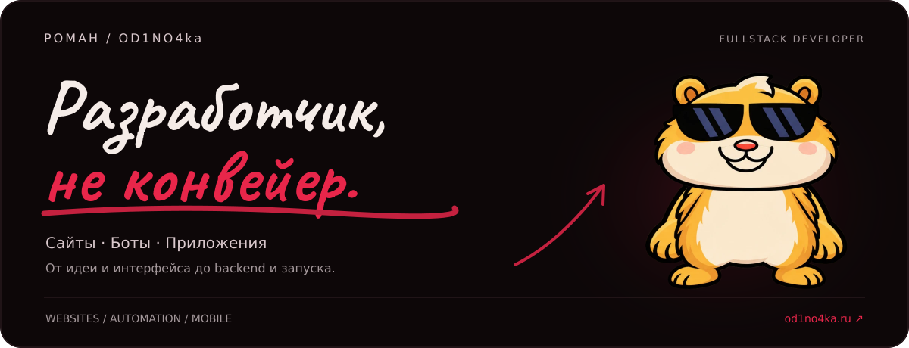

  

  
  
  

  <a href="#обо-мне">Обо мне</a> &nbsp; / &nbsp;
  <a href="#что-разрабатываю">Направления</a> &nbsp; / &nbsp;
  <a href="#технологии">Технологии</a> &nbsp; / &nbsp;
  <a href="#english">English</a>

## Обо мне

Я **Роман**, fullstack-разработчик. Делаю сайты, ботов и приложения под задачу: продумываю интерфейс, пишу frontend и backend, подключаю интеграции и довожу продукт до запуска.

Работаю напрямую: со мной можно обсудить идею, посмотреть промежуточный результат и решить, что делать дальше.

Учусь в **ЮФУ, ИКТИБ** на направлении «Информационная безопасность автоматизированных систем».

> **Один проект — целиком.** От первого разговора и прототипа до работающего продукта.

## Что разрабатываю

| Направление | Чем могу помочь |
| :--- | :--- |
| **Сайты и веб-сервисы** | Лендинги, корпоративные сайты, интернет-магазины, личные кабинеты и веб-приложения |
| **Боты и Mini Apps** | Telegram, MAX, VK, WhatsApp и Discord: заявки, запись, платежи, рассылки, CRM и админки |
| **Мобильные приложения** | Приложения на Flutter для iOS и Android |
| **Софт и автоматизация** | Парсеры, обработка данных и видео, интеграции с API и инструменты для повседневных задач |
| **Развитие проекта** | Доработка, редизайн, SEO-оптимизация, размещение на хостинге и поддержка |

**Стоимость зависит от задачи.** Актуальные цены и калькулятор — [на сайте →](https://od1no4ka.ru/#prices). После обсуждения согласуем объём, стоимость и сроки до старта.

## Технологии

  
  
  
  
  

  
  
  
  
  
  

## Как работаю

**01 · Разбираемся в задаче**  
Обсуждаем цель, примеры и нужные функции. Договариваемся об объёме, стоимости и сроках.

**02 · Собираем продукт**  
Проектирую интерфейс, разрабатываю функциональность и показываю результат по ходу работы.

**03 · Проверяем и запускаем**  
Тестируем основные сценарии, размещаем проект и обсуждаем дальнейшую поддержку.

## English

<b>About me &amp; services</b>

 

I'm **Roman**, a fullstack developer. I build websites, bots and mobile apps, taking projects from the first idea and interface design through backend development, integrations and launch.

I'm studying **Information Security of Automated Systems** at Southern Federal University, ICTIS.

**What I build:**

- Landing pages, company websites, online stores and web applications.
- Telegram bots, Mini Apps, booking flows, payments, CRM and admin tools.
- Cross-platform mobile apps with Flutter.
- Automation scripts, parsers, API integrations and custom software.
- Improvements to existing products, SEO, deployment and maintenance.

I work directly with clients and share progress throughout development. Scope, price and timeline are agreed before work starts.

[Portfolio & pricing →](https://od1no4ka.ru) · [Let's talk →](https://t.me/coder_od1no4ka)

## GitHub

<b>Статистика и активность / Stats &amp; activity</b>

 

  

  

---

<strong>Есть идея? Давай превратим её в работающий проект.</strong>

  <a href="https://t.me/coder_od1no4ka">Написать в Telegram ↗</a> &nbsp; · &nbsp;
  <a href="https://od1no4ka.ru/works">Смотреть работы</a> &nbsp; · &nbsp;
  <a href="https://kwork.ru/user/coder_od1no4ka">Отзывы на Kwork</a>

  <a href="https://t.me/kanal_od1no4ka">No Code No Life — проекты и заметки</a> &nbsp; · &nbsp;
  <a href="https://t.me/od1no4kabot">Бот-портфолио</a>

