<!-- Custom artwork and source-price notes: assets/CREDITS.md -->

  <a href="https://od1no4ka.ru">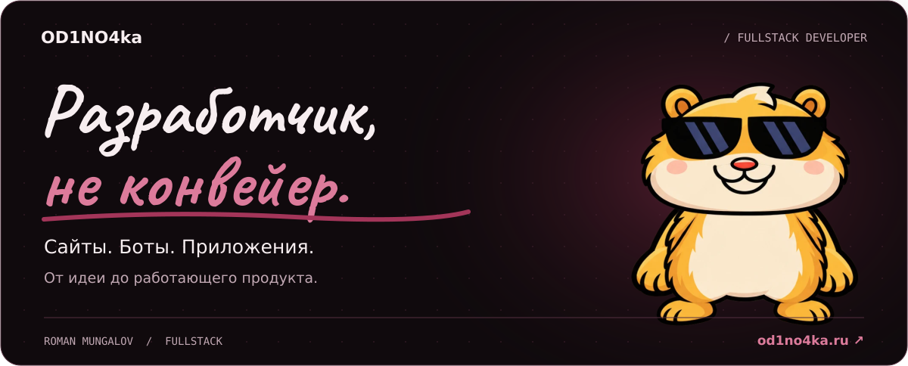</a>

  
  
  

  <a href="#about">Обо мне</a> &nbsp; / &nbsp;
  <a href="#services">Направления</a> &nbsp; / &nbsp;
  <a href="#stack">Стек</a> &nbsp; / &nbsp;
  <a href="#prices">Цены</a> &nbsp; / &nbsp;
  <a href="#english">English</a>

 

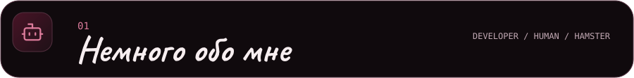

Я **Роман**, fullstack-разработчик. Создаю сайты, ботов и приложения: от интерфейса до серверной логики, интеграций и запуска.

**Работаю напрямую.** Разбираюсь в задаче, показываю результат по ходу разработки и довожу проект до рабочего состояния. Со мной можно обсудить и новый продукт, и доработку существующего.

Учусь в **ЮФУ, ИКТИБ** на направлении «Информационная безопасность автоматизированных систем».

> **Один проект — целиком.** Идея → интерфейс → frontend и backend → запуск.

 

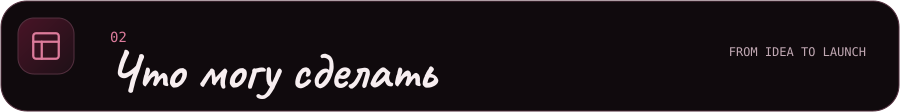

<a href="https://od1no4ka.ru/works">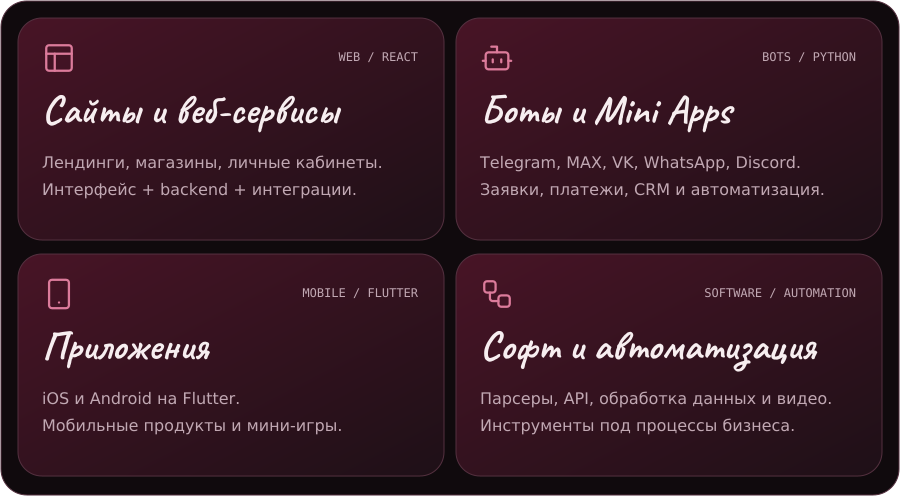</a>

**Уже есть проект?** Помогу с доработкой, редизайном, SEO-оптимизацией, размещением и поддержкой.

[Смотреть работы ↗](https://od1no4ka.ru/works)

 

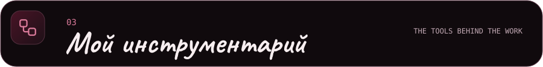

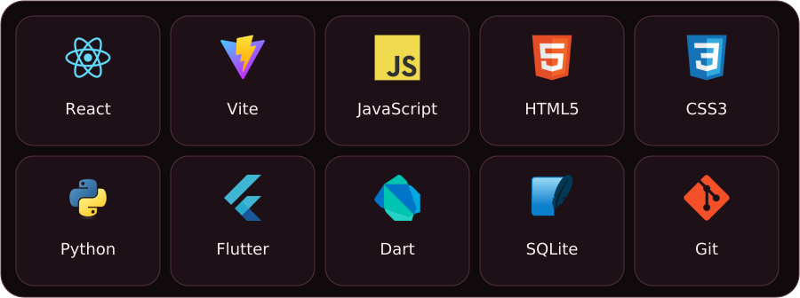

**Для ботов:** aiogram и Pyrogram. **Для связи между сервисами:** API, интеграции, автоматизация.

 

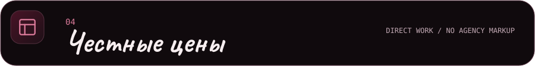

Стоимость **от** — за базовый объём. Точную цену и сроки согласуем после обсуждения задачи, до начала работы.

<a href="https://od1no4ka.ru/#prices">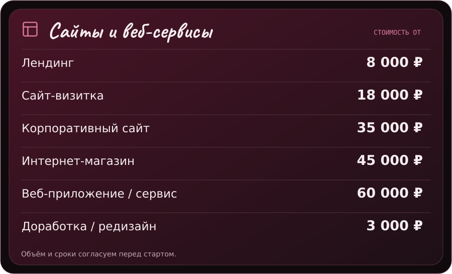</a>

<a href="https://od1no4ka.ru/#prices">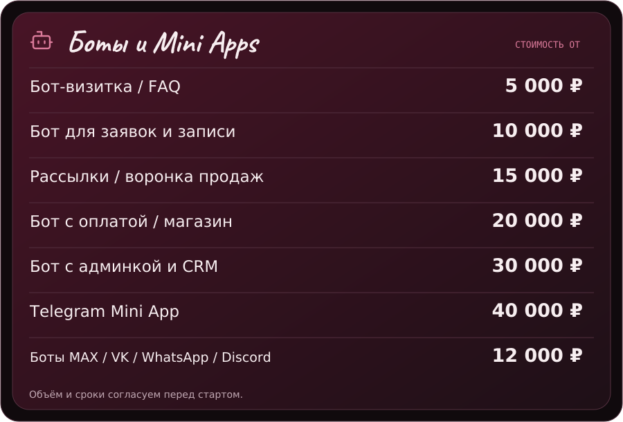</a>

<a href="https://od1no4ka.ru/#prices">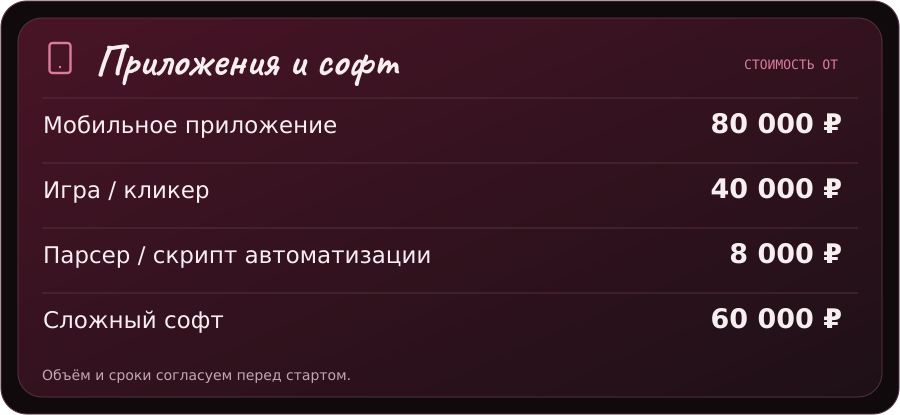</a>

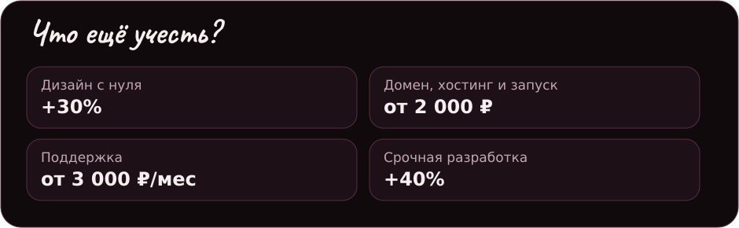

**SEO-база — от 5 000 ₽.** Остальные функции и интеграции можно выбрать в [калькуляторе на сайте ↗](https://od1no4ka.ru/#prices).

<b>Весь прайс текстом / Price list</b>

| Услуга | Стоимость |
| :--- | ---: |
| Лендинг | от 8 000 ₽ |
| Сайт-визитка | от 18 000 ₽ |
| Корпоративный сайт | от 35 000 ₽ |
| Интернет-магазин | от 45 000 ₽ |
| Веб-приложение / сервис | от 60 000 ₽ |
| Доработка / редизайн | от 3 000 ₽ |
| Бот-визитка / FAQ | от 5 000 ₽ |
| Бот для заявок и записи | от 10 000 ₽ |
| Рассылки / воронка продаж | от 15 000 ₽ |
| Бот с оплатой / магазин | от 20 000 ₽ |
| Бот с админкой и CRM | от 30 000 ₽ |
| Telegram Mini App | от 40 000 ₽ |
| Боты MAX / VK / WhatsApp / Discord | от 12 000 ₽ |
| Мобильное приложение | от 80 000 ₽ |
| Игра / кликер | от 40 000 ₽ |
| Парсер / скрипт автоматизации | от 8 000 ₽ |
| Сложный софт | от 60 000 ₽ |

Дизайн с нуля — **+30%** · Домен, хостинг и запуск — **от 2 000 ₽** · Поддержка — **от 3 000 ₽/мес** · Срочно — **+40%**.

Источник цен: [прайс сайта](https://od1no4ka.ru/#prices).

 

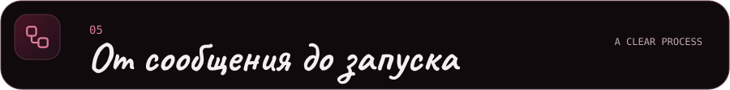

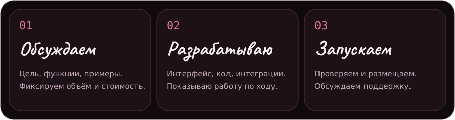

 

<b>About me &amp; services</b>

 

I'm **Roman**, a fullstack developer. I build websites, bots and mobile apps, taking projects from the first idea and interface design through backend development, integrations and launch.

I'm studying **Information Security of Automated Systems** at Southern Federal University, ICTIS.

**What I build:**

- Landing pages, company websites, online stores and web applications.
- Telegram bots, Mini Apps, booking flows, payments, CRM and admin tools.
- Cross-platform mobile apps with Flutter.
- Automation scripts, parsers, API integrations and custom software.
- Improvements to existing products, SEO, deployment and maintenance.

I work directly with clients and share progress throughout development. Scope, price and timeline are agreed before work starts.

[Portfolio & pricing →](https://od1no4ka.ru) · [Let's talk →](https://t.me/coder_od1no4ka)

<b>GitHub / Статистика и активность</b>

 

  

  

 

<a href="https://t.me/coder_od1no4ka">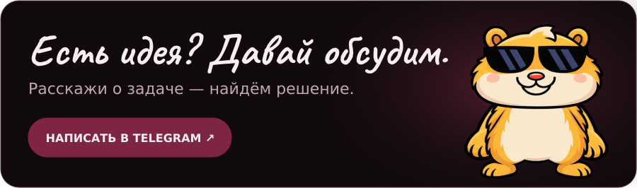</a>

  <a href="https://od1no4ka.ru">Портфолио ↗</a> &nbsp; · &nbsp;
  <a href="https://t.me/kanal_od1no4ka">No Code No Life — проекты и заметки</a> &nbsp; · &nbsp;
  <a href="https://t.me/od1no4kabot">Бот-портфолио</a>

